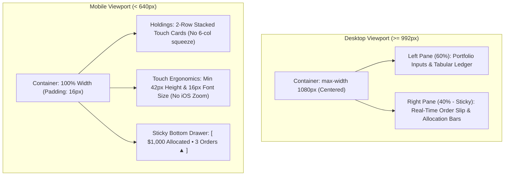

# Institutional FinTech UI/UX & Anti-Vibe-Coding Design System

This skill equips the agent with institutional wealth management design
principles, high-density financial data ergonomics, anti-vibe-coding heuristics,
and adaptive responsive layout contracts to engineer professional, trustworthy
financial interfaces that convey permanence, security, and precision.

---

## 1. The Anti-Vibe-Coding Heuristics (Strict Prohibitions)

Vibe-coding is the superficial application of trendy, unexamined UI tropes that
signal an amateur prototype or AI-generated weekend hack. In financial software,
these tropes destroy user trust and willingness to pay.

### Explicit Prohibitions:
* **No Web3 / Crypto-DEX Styling:**
  * Ban saturated neon accents (e.g. radioactive mint `#24DBA1` on `#0B0C0E`).
  * Ban radial blur glows and neon outline halos
    (`box-shadow: 0 0 12px var(--accent-glow)`).
  * Ban dark-mode-only exclusivity. A first-class, high-contrast Light Mode is
    mandatory for serious self-directed investors.
* **No Fidget-Spinner Micro-Animations:**
  * Ban spinning gear icons (`rotate(45deg)` on hover), tilting info buttons
    (`rotate(15deg)`), and bouncing transforms (`scale(1.05)`).
  * Hover states must be calm, instantaneous, and purposeful: subtle background
    tint shifts, 1px border highlight, or slight opacity transitions
    ($\le 120$ms).
* **No Hacker-Terminal / ASCII Gimmicks:**
  * Ban matrix-green ASCII terminal receipts in production financial tools.
  * Replace with a structured, copyable **Broker Order Ticket Slip** that
    matches real-world trade order entries (VAS, VGS, units, estimated cost).
* **No Unexamined AI Scaffolding or Broken Markup:**
  * Zero tolerance for placeholder text left in production dialogs (e.g.
    `<h3>Hello World!</h3>` in guide tabs).
  * Zero tolerance for mangled, unclosed, or inverted SVG tags.
* **No Structural Pill Bloat & Clean Borderless Pill Aesthetic:**
  * Ban `border-radius: 9999px` (pills) on structural elements, inputs, tables,
    and cards.
  * Restrict pill shapes exclusively to compact status indicators, tags,
    and badges.
  * **Borderless Pill Rule:** All pills, tags, and badges must strictly have
    a clean, borderless aesthetic (`border: none;` or `border: 0;`). Never
    apply hairline outlines around rounded pill shapes; distinguish them
    purely through disciplined background tints and high-contrast typography.
  * Card and input border-radii must adhere to a disciplined `6px`–`8px` grid.
* **No Modal Overload:**
  * Do not force users into a full-screen backdrop modal for simple preference
    toggles or minor views. Reserve modals strictly for high-consequence
    security actions (wiping an unreadable vault, exporting master keys).

---

## 2. Institutional Design System & Token Architecture

Institutional tools (Linear, Wealthfront, Stripe Dashboard, FactSet) project
restraint, legibility, and mathematical rigor.

### A. Color & Elevation Tokens
* **Dark Mode Palette:**
  * Primary Base: Deep neutral graphite (`#0F1115` / `#121418`), not pure black.
  * Card Surfaces: `#181B20` (subtle contrast, no muddy opacity).
  * Elevated Containers: `#1F232B`.
  * Hairline Borders: Crisp `1px solid rgba(255, 255, 255, 0.08)`.
  * Primary Accent: Institutional emerald (`#10B981` / `#059669`) or disciplined
    slate-blue (`#2563EB`). Calm, authoritative, and legible.
  * Elevation: Sharp, flat 1px borders with tight, subtle drop-shadows
    (`0 4px 12px rgba(0, 0, 0, 0.2)`). Zero neon blur glows.
* **Light Mode Palette (First-Class Citizen):**
  * Primary Base: `#F8F9FA` / `#F4F5F7`.
  * Card Surfaces: Pure `#FFFFFF`.
  * Hairline Borders: Crisp `1px solid #E2E8F0` / `#CBD5E1`.
  * High-Contrast Text: Deep slate `#0F172A` (headers) and `#334155` (body).

### B. Typography & Number Alignment Standards
* **Dual-Font Role Separation:**
  * **System / UI Font:** Crisp sans-serif (Plus Jakarta Sans, Inter, or Geist)
    for labels, section headers, instructions, and navigation.
  * **Numeric / Data Font:** High-legibility monospace (JetBrains Mono) for all
    financial values, share prices, quantities, target weights, and ticker tags.
* **Tabular Figures Guarantee:**
  * Enforce `font-variant-numeric: tabular-nums` across all numeric inputs and
    readouts. Digits must occupy identical horizontal widths to eliminate visual
    jitter during real-time updates.
* **Strict Alignment:**
  * Monetary numbers, prices, and weights must be **right-aligned**.
  * Tickers and descriptions must be **left-aligned**.
  * Status badges and row indices must be **centered**.

---

## 3. Responsive Layout Contracts: Desktop vs. Mobile

Desktop and Mobile serve fundamentally different ergonomic contexts. Squeezing
a 6-column spreadsheet into a phone screen is an anti-pattern.

### A. Desktop Specification (`min-width: 992px`)
1. **Container Width:** Expand from narrow 620px to a comfortable `1080px` or
   `1140px` max-width.
2. **Two-Pane Split Architecture:**
   * **Left Rail (58%–60%):** Deposit well, Mode switcher, and the complete
     6-column financial ledger table.
   * **Right Rail (40%–42% - Sticky):** Sticks in view during scrolling.
     Contains the Stat Grid, Comparative Progress Bars, Leftover Cash alert, and
     the 1-click Broker Order Slip.
3. **Reactive Calculation:**
   * Rebalance calculations run reactively on input with an 80ms debounce.
   * Eliminates the sudden, jarring vertical jump caused by clicking an
     old-style `Calculate` button.

### B. Mobile Specification (`max-width: 639px`)
1. **Adaptive Card Transformation (No Table Squeeze):**
   * Discard the 6-column table row.
   * Render each holding as a **2-row stacked touch card**:
     * **Row 1:** Asset Ticker (bold, left), Target % badge (center), and
       generously padded Delete button (`✕`, right).
     * **Row 2:** Three thumb-friendly input boxes side-by-side: Share Price,
       Quantity, and Calculated Current Value.
2. **Touch Targets & iOS Zoom Prevention:**
   * Every input field must have a minimum height of `42px` and a font-size of
     **at least `16px`** on mobile screens. (Font sizes $< 16\text{px}$ trigger
     automatic viewport zooming on Apple iOS Safari).
3. **Floating Bottom Order Drawer:**
   * Instead of hiding rebalance results off-screen below a long holding list,
     render a sticky floating summary bar at the bottom of the viewport:
     `[ $1,000 Allocated • 3 Buys Needed   View Ticket ▲ ]`.
   * Tapping opens a smooth slide-up bottom sheet showing the proposed orders.

---

## 4. Codebase Constraints & Quality Assurance Checklist

When implementing front-end refactors under this skill:

1. **Strict 80-Character Rule:** Every line of HTML, CSS, JavaScript, and SQL
   must strictly not exceed 80 characters.
2. **100% Test Invariant Preservation:**
   * Layout refactoring must **never remove or break existing DOM IDs and
     classes** relied upon by `tests/master_test_suite.js`.
   * Specifically preserve: `#tableHeaders`, `#portfolioContainer`, `#deposit`,
     `#minBuy`, `#minBuyWell`, `#meterFill`, `#btnCalc`, `#sortFieldSelect`,
     `#sortDirBtn`, `#allocationList`, `#statInitial`, `#statDeposit`,
     `#statNewTotal`, `#thresholdWarning`, and `#normNotice`.
3. **Zero Framework Policy:** All styling must execute via standard CSS Custom
   Properties without introducing external libraries or bloated build steps.
4. **Parity Enforcement:** Any modification to `GitHub/Rebalance/index.html`
   must be mirrored byte-for-byte to
   `c:\Users\willi\Desktop\Rebalancing\index.html` and verified
   with `fc.exe /b`.
5. **Deterministic Testing:** Run `node tests/run_all.js` before completing any
   task. All 239 tests and 3,000 fuzz simulations must pass.

