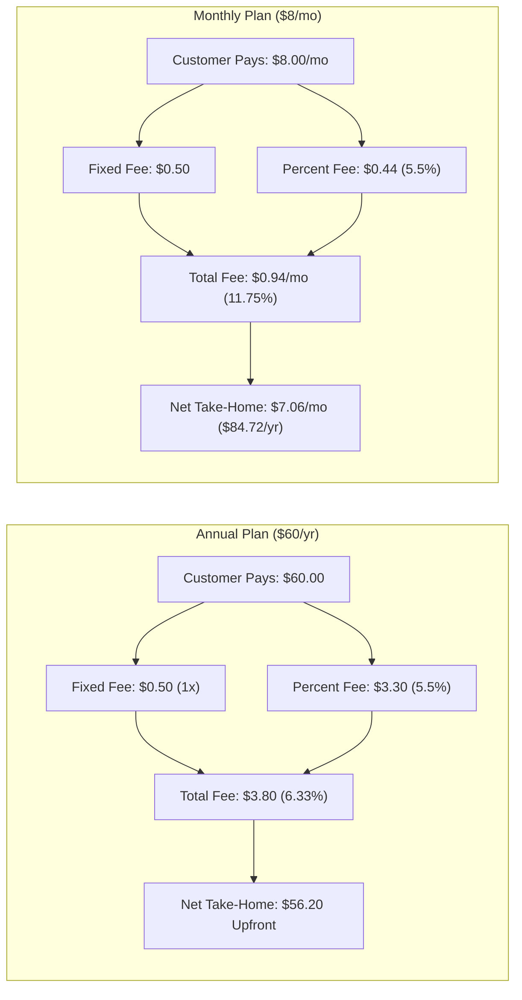

1# Pro Tier Specification & Monetization Blueprint

This document defines the product tiering, pricing strategy, economic modeling,
and payment infrastructure for the Portfolio Rebalancer. It serves as the
single source of truth for all future development relating to paid accounts,
subscriptions, and billing.

---

## 1. Product Tiering Philosophy: "Never Paywall the Math"

### Core Principle
> **Never paywall arithmetic. Paywall convenience, ongoing compute, external
> API costs, and scale.**

Calculating fractional shares, rounding whole shares, or determining optimal
allocations costs \$0.00 in compute and runs entirely on the user's browser.
Artificially crippling the mathematical engine or forcing a cash remainder
behind a paywall creates immediate backlash, negative reviews, and prompts
users to revert to spreadsheets. 

Trust is our primary growth engine. The free tier must remain mathematically
complete, privacy-respecting, and exceptionally useful on its own.

### Feature Matrix

| Feature | Free | Pro | Rationale |
| :--- | :---: | :---: | :--- |
| **Math Engine** | **Full** | **Full** | Pure client math; builds trust. |
| **Input Modes** | Both | Both | Whole rounding & fractional division. |
| **Rebalance Types** | Both | Both | Core rebalance is unrestricted. |
| **Client Privacy** | PBKDF2/AES | PBKDF2/AES | Fundamental human right. |
| **Portfolios** | 1 | Unlimited | Multi-portfolio isolation. |
| **Holdings** | Up to 8 | Unlimited | Simple vs complex portfolios. |
| **Market Data** | Manual | Live Feeds | External API costs require sub. |
| **Monitoring** | Manual | Daily Crons | Daily worker crons & email alerts. |
| **Cloud Sync** | 1 Device | Multi-Device | Cross-device encrypted sync. |

---

## 2. Pricing Structure & Anchor Economics

Rebalancing is an **intermittent activity** (conducted monthly, quarterly, or
bi-annually). Relying purely on month-to-month billing results in high seasonal
churn (subscribing for 1 month, rebalancing, and canceling). 

To solve this, we use **Price Anchoring**:

### Founder / Launch Phase (First 500 Subscribers)
* **Annual Early Bird:** **\$48.00 / year** (framed as **"\$4.00 / month, locked
  in for life"**).
* **Monthly Plan:** **\$5.00 / month** (low-friction test drive).
* **Grandfathering:** The \$48/yr rate remains active as long as the
  subscription is maintained continuously.

### Mature Phase (Post-500 Subscribers)

| Plan | Price | Framing Anchor | Effective Monthly |
| :--- | :--- | :--- | :--- |
| **Annual (Default)** | **\$60.00 / yr** | **"Save 38%"** | **\$5.00 / mo** |
| **Monthly** | **\$8.00 / mo** | **"Cancel anytime"** | **\$8.00 / mo** |

### Why This Pairing Works
1. **Clean Cognitive Math:** \$60 / 12 = **\$5.00/month flat**. Users instantly
   understand the value without cognitive friction.
2. **Portfolio Perspective:** On a modest \$20,000 to \$50,000 portfolio,
   \$60/year is only **0.12% to 0.30%** of assets—vastly cheaper than financial
   advisors (1.00%) or heavy tracking tools (\$100–\$150/year).
3. **High Upfront LTV:** The annual savings nudges 80%+ of converting users
   into the upfront plan, eliminating monthly churn and providing upfront cash
   flow.

---

## 3. Merchant of Record (MoR) Architecture: Lemon Squeezy

We use **Lemon Squeezy** (acquired by **Stripe** in July 2024) as our
**Merchant of Record (MoR)**.

### Why an MoR Instead of Standard Stripe?
* **Zero Tax Liability:** Standard Stripe is merely a payment processor; the
  developer is legally liable for registering, collecting, and filing sales
  tax/VAT across 50 US states, the EU (VAT OSS), the UK (HMRC), and Australia
  (GST).
* **Authorized Reseller:** Lemon Squeezy legally acts as the reseller. They
  calculate, collect, and remit all global taxes under their corporate entity.
  The developer receives clean, consolidated payouts with zero
  multi-jurisdiction tax filings.
* **Stripe Infrastructure:** Backed by Stripe's global banking rails, fraud
  prevention, and uptime.

### Transaction Fee Modeling

Lemon Squeezy charges **5.5% + \$0.50** per recurring subscription transaction
(+1.5% for international non-US cards):



### Key Fee Takeaways:
* **The Fixed \$0.50 Fee Punishes Monthly Billing:** On \$8/mo, the \$0.50 fixed
  charge eats 6.25% of revenue by itself, driving total fees to **11.75%**.
* **Annual Maximizes Margins:** On \$60/yr, the fixed fee is paid only once,
  keeping total fees down to **6.33%** and leaving **\$56.20 net** on Day 1.
* **The Spread is Justified:** Charging \$8/mo absorbs the \$0.90+ fee drag and
  covers monthly churn risk, while preserving healthy margins.

---

## 4. Technical Integration Architecture

### Database Schema (Cloudflare D1)
The `accounts` table in `backend/schema.sql` is configured for subscription
tracking:

```sql
CREATE TABLE accounts (
    email TEXT PRIMARY KEY,
    auth_hash TEXT NOT NULL,
    schema_version INTEGER NOT NULL DEFAULT 2,
    vault_version INTEGER NOT NULL DEFAULT 1,
    vault_ciphertext TEXT,
    recovery_envelope TEXT,
    tier TEXT NOT NULL DEFAULT 'free',                 -- 'free' | 'pro'
    stripe_customer_id TEXT,                          -- Customer ID
    subscription_status TEXT NOT NULL DEFAULT 'none', -- 'none' | 'active'
    subscription_expires_at TEXT,                     -- ISO timestamp
    preferences TEXT NOT NULL DEFAULT
        '{"currency":"USD","theme":"auto","autoSync":true}',
    created_at TEXT NOT NULL,
    updated_at TEXT NOT NULL,
    last_login_at TEXT NOT NULL
);
```

### Frontend Checkout Flow (`index.html`)
1. User clicks **"Upgrade to Pro"**.
2. Lemon Squeezy's hosted overlay modal is triggered via `lemon.js`:
   ```javascript
   function openLemonCheckout(variantId) {
       const email = currentAccount?.email || '';
       const base = 'https://rebalance.lemonsqueezy.com/buy/' + variantId;
       const encEmail = encodeURIComponent(email);
       const checkoutUrl =
           `${base}?checkout[email]=${encEmail}` +
           `&checkout[custom][user_email]=${encEmail}`;
       LemonSqueezy.Url.Open(checkoutUrl);
   }
   ```
3. When checkout succeeds, `lemon.js` fires a `Checkout.Success` event in the
   browser, prompting the client to refresh its session and instantly reveal
   Pro features.

### Backend Webhook Handler (`backend/src/index.js`)
* **Endpoint:** `POST /api/webhooks/lemonsqueezy`
* **Security:** Verifies the `X-Signature` HMAC-SHA256 header using
  `crypto.subtle` against `env.LEMONSQUEEZY_WEBHOOK_SECRET`.
* **Events Handled:**
  * `subscription_created` / `order_created`:
    ```sql
    UPDATE accounts 
    SET tier = 'pro', subscription_status = 'active',
        subscription_expires_at = ? 
    WHERE email = ?;
    ```
  * `subscription_updated`: Updates renewal date or tier.
  * `subscription_cancelled`: Keeps `tier = 'pro'` until
    `subscription_expires_at`, sets `subscription_status = 'cancelled'`.
  * `subscription_expired`: Reverts `tier = 'free'`, sets
    `subscription_status = 'expired'`.

### Customer Billing Management (Self-Serve Portal)
* No custom billing management code or credit card update forms are needed in
  the application.
* Lemon Squeezy provides a hosted **Customer Portal**.
* A simple *"Manage Subscription"* link in Settings -> Account redirects the
  user to their authenticated Lemon Squeezy billing portal.

### Clean Slate Reset Security for Pro Accounts
* When a Pro user forgets their master password and loses their emergency
  recovery key, Option B allows wiping unreadable vaults to restore account
  access.
* To prevent email takeover attacks against paid subscriptions, Pro accounts
  require verifying **both** a 6-digit email OTP **and** the **Last 4 Digits of
  the Payment Card on File** (cross-checked against the payment processor
  customer record).

---

## 5. Support & Feedback Infrastructure

* **Decoupled Support Routing:** All customer support, dispute inquiries, and
  feedback communications route through the decoupled configuration module
  defined in [`config.js`][config-file] via `REBALANCE_CONFIG.supportEmail`:
  ```javascript
  supportEmail: 'rebalancecalculator@gmail.com'
  ```
* **Privacy & Decoupling:** Eliminates personal identifier exposure across
  public, documentation, and client-facing interfaces while providing users
  with a dedicated contact channel for billing and application feedback.

[config-file]:
  file:///c:/Users/willi/Desktop/Rebalancing/GitHub/Rebalance/config.js
