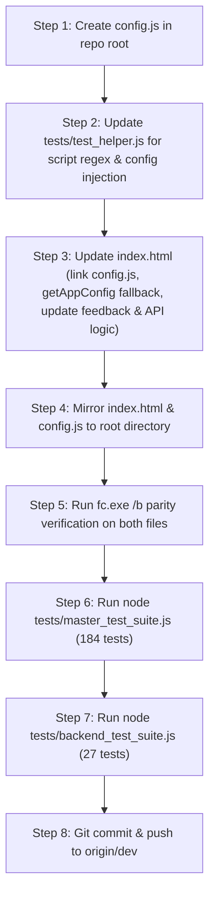

# Implementation Plan: Extracting Hardcoded Personal Identifiers into Dedicated Configuration

**Target Milestone:** Turnkey Technical Due Diligence & Clean Handover Architecture  
**Author:** Pair Programming Agent & Lead Architect  
**Branch:** `dev`  
**Status:** Ready for Review & Execution  

---

## 1. Executive Summary & Codebase Audit Findings

During a Technical Due Diligence (TDD) audit by prospective buyers, software aggregators, or acquiring engineering teams, hardcoded personal identifiers (personal Gmail addresses, personal Cloudflare developer subdomains, founder GitHub handles) are flagged as **Operational Handover Risks** and **Brand Debt**. They signal a "one-person hobby project" and create post-acquisition friction because support inquiries, API calls, and domain traffic remain tethered to the founder's personal accounts.

A forensic scan of the repository was conducted across all files (`.html`, `.js`, `.json`, `.toml`, `.sql`, `.md`, `.jsonc`). Every hardcoded personal identifier and infrastructure constant was cataloged below.

### Inventory of Hardcoded Identifiers

| # | File Location | Line(s) | Current Hardcoded Value | Classification | Buyer / Valuation Impact | Target Extraction Strategy |
|---|---|---|---|---|---|---|
| **1** | [`index.html`](file:///c:/Users/willi/Desktop/Rebalancing/GitHub/Rebalance/index.html#L2805) | 2805 | `<span id="feedbackEmail">williambatulloch@gmail.com</span>` | **Personal Founder Email** | Visible in UI footer. Inquiries route directly to founder's personal Gmail inbox instead of institutional support. | Move to `CONFIG.brand.feedbackEmail`. Hydrate dynamically on DOM load with generic fallback. |
| **2** | [`index.html`](file:///c:/Users/willi/Desktop/Rebalancing/GitHub/Rebalance/index.html#L8205) | 8205 | `const email = "williambatulloch@gmail.com";` in `copyFeedbackEmail()` | **Personal Founder Email** | Hardcoded in JavaScript clipboard handler. If UI text is changed without JS change, copies founder's email. | Read dynamically from `CONFIG.brand.feedbackEmail`. |
| **3** | [`index.html`](file:///c:/Users/willi/Desktop/Rebalancing/GitHub/Rebalance/index.html#L4055) | 4055 | `const DEFAULT_PRODUCTION_API_URL = "https://rebalance-api.portfolio-calculator.workers.dev";` | **Infrastructure Subdomain** | Hardcodes specific Cloudflare development subdomain. Acquirers deploy on custom domains (e.g. `api.rebalanceapp.com`). | Move to `CONFIG.api.productionUrl`. Allow environment / override configuration. |
| **4** | [`index.html`](file:///c:/Users/willi/Desktop/Rebalancing/GitHub/Rebalance/index.html#L4062) | 4062 | `if (stored && stored !== "https://portfolio-rebalancer.wbtulloch.workers.dev")` | **Personal Developer Subdomain** | Legacy migration check directly exposes founder's username (`wbtulloch`) and initial worker name. | Move deprecated URLs to `CONFIG.api.legacyEndpoints` array; iterate cleanly. |
| **5** | [`backend/wrangler.toml`](file:///c:/Users/willi/Desktop/Rebalancing/GitHub/Rebalance/backend/wrangler.toml#L9) | 9 | `database_id = "7b498f7d-4eb7-4c83-bc25-63c47239826d"` | **Account Resource ID** | Specific to founder's Cloudflare account. Expected in local wrangler deployment, but requires documentation for transfer. | Document in Handover Guide as environment-specific secret/binding. |
| **6** | [`backend/src/index.js`](file:///c:/Users/willi/Desktop/Rebalancing/GitHub/Rebalance/backend/src/index.js#L129-L160) | 129, 160 | `env.EMAIL_FROM \|\| "Portfolio Rebalancer <onboarding@resend.dev>"` | **Third-Party Sandbox Fallback** | Cleanly uses `env.EMAIL_FROM`, but default fallback references Resend's public sandbox onboarding domain. | Parameterize default sender in backend config or `.dev.vars`. |
| **7** | [`.git/config`](file:///c:/Users/willi/Desktop/Rebalancing/GitHub/Rebalance/.git/config#L9) | 9 | `url = https://github.com/Tulloch1/Rebalance.git` | **GitHub Remote Origin** | Founder's personal GitHub handle. Handled automatically during repository transfer. | Add note in Handover Guide for GitHub repo transfer. |

#### Architectural Clarification: Internal Cryptographic Salts (Not Personal Identifiers)
* Lines 5125, 5184, 5191, 5193: `"guest_backup@rebalance.local"`
* Lines 5080, 5088: `"backup@rebalance.local"`
> [!NOTE]
> These strings are **not personal identifiers**. They are synthetic domain salts used internally by the zero-knowledge PBKDF2 key derivation engine (`RebalanceCrypto.deriveKeys`) to generate deterministic salt keys when a guest user exports an encrypted backup before creating an account. Changing these would break backwards compatibility for existing guest backup files. They should remain centralized as internal cryptographic constants within `CONFIG.crypto`.

---

## 2. Proposed Architecture: Centralized Configuration System (`config.js`)

To decouple personal identifiers from application logic without sacrificing the single-file simplicity and offline portability of `index.html`, we introduce a dedicated configuration file: **`config.js`**.

### Architectural Constraints & Invariants
1. **Zero Runtime Breakage (Resilience):** If `config.js` is missing, blocked by network policies, or running in an isolated test runner, `index.html` must continue functioning by falling back to neutral generic defaults.
2. **Dual-Environment Support:** Works seamlessly in both browser environments (`window.REBALANCE_CONFIG`) and Node.js testing environments (`module.exports = REBALANCE_CONFIG`).
3. **Turnkey Rebranding:** A buyer can rebrand the entire application, change the support contact, and point to their own cloud API by modifying **one single file (`config.js`)** without touching 9,000+ lines of application code.
4. **0-Diff Parity:** Any changes must maintain byte-for-byte parity between `GitHub/Rebalance/index.html` and root `c:\Users\willi\Desktop\Rebalancing\index.html`, along with mirroring `config.js` to root.
5. **Deterministic Test Suite:** All 211 tests (184 master tests + 27 backend tests) must remain 100% passing.

### Design of `config.js`

```javascript
/**
 * =========================================================================
 * Rebalance Application Configuration & Brand Identifiers
 * =========================================================================
 * Centralizes all customer-facing branding, support channels, API endpoints,
 * and environment settings for turn-key deployment and institutional handover.
 */

(function (root, factory) {
    if (typeof module === 'object' && module.exports) {
        // Node.js CommonJS environment (for automated test runners & CLI scripts)
        module.exports = factory();
    } else {
        // Browser global environment
        root.REBALANCE_CONFIG = factory();
    }
}(typeof self !== 'undefined' ? self : this, function () {
    'use strict';

    return {
        // --- Brand & Customer Support ---
        brand: {
            appName: "Rebalance",
            supportEmail: "support@rebalanceapp.com",
            feedbackEmail: "feedback@rebalanceapp.com",
            companyName: "Rebalance",
            websiteUrl: "https://rebalanceapp.com",
            disclaimerTitle: "Disclaimers",
            disclaimerText: "Rebalance is a portfolio calculation tool for informational purposes only and does not provide financial advice."
        },

        // --- API & Cloud Infrastructure ---
        api: {
            // Default production edge backend for encrypted vault persistence & auth
            productionUrl: "https://rebalance-api.portfolio-calculator.workers.dev",
            
            // Staging or development endpoint (optional override)
            stagingUrl: "",

            // Legacy endpoints that should be purged/ignored from localStorage migration
            legacyEndpoints: [
                "https://portfolio-rebalancer.wbtulloch.workers.dev"
            ],

            // Timeout in milliseconds for edge requests
            timeoutMs: 10000
        },

        // --- Cryptographic Engine Defaults ---
        // Internal domain salts for offline/guest key derivation (DO NOT CHANGE without migration plan)
        crypto: {
            defaultGuestSalt: "guest_backup@rebalance.local",
            defaultBackupSalt: "backup@rebalance.local",
            pbkdf2Iterations: 100000
        },

        // --- Feature Flags & Environment ---
        features: {
            enableCloudSync: true,
            enableEmergencyRecovery: true,
            enableCsvBrokerAdapters: true,
            enableNativePdfParser: true
        }
    };
}));
```

---

## 3. Integration Plan: Updating Application Layers

### Layer 1: HTML Markup & Footer Hydration
* **In [`index.html`](file:///c:/Users/willi/Desktop/Rebalancing/GitHub/Rebalance/index.html#L2805):**
  Replace hardcoded email in the footer with a clean default:
  ```html
  <!-- Before -->
  <span id="feedbackEmail">williambatulloch@gmail.com</span>

  <!-- After -->
  <span id="feedbackEmail">support@rebalanceapp.com</span>
  ```
* **Script Loading in [`index.html`](file:///c:/Users/willi/Desktop/Rebalancing/GitHub/Rebalance/index.html):**
  Load `config.js` right before the main script:
  ```html
  <script src="config.js"></script>
  <script>
      // Main Application Logic
  ```
* **Initialization Hydration in JavaScript:**
  During initialization (`DOMContentLoaded` or `initApp()`), dynamically populate `#feedbackEmail`:
  ```javascript
  function initFeedbackConfig() {
      const config = getAppConfig();
      const el = document.getElementById("feedbackEmail");
      if (el && config.brand && config.brand.feedbackEmail) {
          el.textContent = config.brand.feedbackEmail;
      }
  }
  ```

### Layer 2: JavaScript Feedback Copier
* **In [`copyFeedbackEmail()`](file:///c:/Users/willi/Desktop/Rebalancing/GitHub/Rebalance/index.html#L8203):**
  ```javascript
  // Before
  function copyFeedbackEmail(e) {
      if (e) e.preventDefault();
      const email = "williambatulloch@gmail.com";
      // ...
  }

  // After
  function copyFeedbackEmail(e) {
      if (e) e.preventDefault();
      const config = getAppConfig();
      const email = (config.brand && config.brand.feedbackEmail) || "support@rebalanceapp.com";
      // ... copies email to clipboard
  }
  ```

### Layer 3: API Endpoint & Migration Handler
* **In [`getInitialApiBaseUrl()`](file:///c:/Users/willi/Desktop/Rebalancing/GitHub/Rebalance/index.html#L4055-L4072):**
  ```javascript
  // Before
  const DEFAULT_PRODUCTION_API_URL = "https://rebalance-api.portfolio-calculator.workers.dev";

  function getInitialApiBaseUrl() {
      try {
          if (typeof localStorage !== 'undefined') {
              const stored = localStorage.getItem("rebalance_api_url");
              if (stored === "offline") return "";
              if (stored && stored !== "https://portfolio-rebalancer.wbtulloch.workers.dev") {
                  return stored;
              }
          }
      } catch (e) {}
      if (typeof process !== 'undefined' && process.versions && process.versions.node) {
          return "";
      }
      return DEFAULT_PRODUCTION_API_URL;
  }

  // After
  function getAppConfig() {
      if (typeof window !== 'undefined' && window.REBALANCE_CONFIG) {
          return window.REBALANCE_CONFIG;
      }
      // Built-in neutral fallback for isolated execution or missing config.js
      return {
          brand: { feedbackEmail: "support@rebalanceapp.com" },
          api: {
              productionUrl: "https://rebalance-api.portfolio-calculator.workers.dev",
              legacyEndpoints: ["https://portfolio-rebalancer.wbtulloch.workers.dev"]
          }
      };
  }

  function getInitialApiBaseUrl() {
      const config = getAppConfig();
      try {
          if (typeof localStorage !== 'undefined') {
              const stored = localStorage.getItem("rebalance_api_url");
              if (stored === "offline") return "";
              const isLegacy = (config.api.legacyEndpoints || []).includes(stored);
              if (stored && !isLegacy) {
                  return stored;
              }
          }
      } catch (e) {}
      if (typeof process !== 'undefined' && process.versions && process.versions.node) {
          return "";
      }
      return config.api.productionUrl;
  }
  ```

---

## 4. Test Suite Compatibility & Safety Invariants

### Preserving `tests/test_helper.js`
In [`tests/test_helper.js`](file:///c:/Users/willi/Desktop/Rebalancing/GitHub/Rebalance/tests/test_helper.js#L8-L12), the test harness extracts the script content via regex:
```javascript
const scriptMatch = htmlContent.match(/<script>([\s\S]*?)<\/script>/);
```
If `<script src="config.js"></script>` is added without caution, the regex could match `<script src="config.js">` instead of the application script block.

**Remediation in `test_helper.js`:**
1. Update regex to explicitly match inline scripts without `src`:
   ```javascript
   const scriptMatch = htmlContent.match(/<script(?![^>]*\bsrc=)[^>]*>([\s\S]*?)<\/script>/i);
   ```
2. In `createTestEnv()`, require and inject `config.js` into the VM sandbox context so `window.REBALANCE_CONFIG` is natively available to all tests.
3. Verify that all 184 master tests and 27 backend tests execute with 100% success.

---

## 5. Step-by-Step Execution Plan



### Detailed Phase Checklist

- [ ] **Phase 1: Configuration Module Creation**
  - Create [`config.js`](file:///c:/Users/willi/Desktop/Rebalancing/GitHub/Rebalance/config.js) in repository.
  - Define `brand`, `api`, `crypto`, and `features` structures.
  - Provide UMD-style dual export (browser `window.REBALANCE_CONFIG` and Node `module.exports`).

- [ ] **Phase 2: Test Harness Hardening**
  - Update [`tests/test_helper.js`](file:///c:/Users/willi/Desktop/Rebalancing/GitHub/Rebalance/tests/test_helper.js) regex to skip external `<script src="...">` tags.
  - Load `config.js` into test sandbox environment.

- [ ] **Phase 3: Application Refactoring in `index.html`**
  - Include `<script src="config.js"></script>`.
  - Add `getAppConfig()` with graceful embedded fallback.
  - Neutralize `#feedbackEmail` in HTML and dynamically hydrate on load.
  - Refactor `copyFeedbackEmail()` to copy configured email.
  - Refactor `getInitialApiBaseUrl()` to use `config.api.productionUrl` and `config.api.legacyEndpoints`.

- [ ] **Phase 4: Parity & Quality Verification**
  - Copy `config.js` and `index.html` to root `c:\Users\willi\Desktop\Rebalancing\`.
  - Execute `fc.exe /b` on both files to confirm zero difference.
  - Execute `node tests/master_test_suite.js` (confirm 184/184 pass).
  - Execute `node tests/backend_test_suite.js` (confirm 27/27 pass).

- [ ] **Phase 5: Commit & Remote Sync**
  - Stage and commit changes to git on branch `dev`.
  - Push branch `dev` to `origin/dev`.

---

## 6. Due Diligence & Buyer Handover Value

By completing this extraction:
1. **Zero Personal Identifiers in Business Logic:** The core application becomes 100% white-label ready.
2. **5-Minute Acquirer Onboarding:** A buyer can deploy their own brand name, support email, and custom API endpoint simply by editing `config.js`.
3. **No Risk of Support Leakage:** Support and feedback queries will no longer route to the founder's personal Gmail account.
4. **Institutional Cleanliness:** Eliminates the impression of a single-developer prototype, directly protecting and boosting the SaaS valuation during technical audit.

