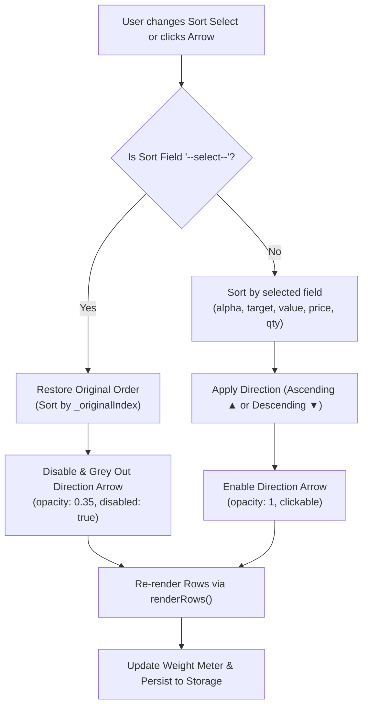

# Implementation Plan: Holdings "Sort By" Feature

**Target Milestone:** Intelligent Holdings Sorting & Order Restoration  
**Branch:** `dev`  
**Status:** Ready for Review  

---

## 1. Overview & Visual Design Inspiration

The user requested a **"Sort By"** feature for portfolio holdings, inspired by the provided reference image:


### Design Translation & Component Anatomy
* **Reference Pattern:** A cohesive capsule/pill featuring a left label/symbol and a right directional arrow indicator (`▼`).
* **Our Implementation:**
  1. **Left Component (Variable Selector):** A dropdown menu displaying the active sort variable. It defaults to **`--select--`** (the user's original input order).
  2. **Right Component (Direction Arrow):** An interactive directional button indicating sort order:
     - **Ascending (`▲`):** Points upward.
     - **Descending (`▼`):** Points downward.
     - **`--select--` Mode:** The arrow button is **disabled and greyed out** (`opacity: 0.35`, `cursor: not-allowed`), communicating that direction only applies to sorted fields.
  3. **Placement:** Located directly to the right of the **Target** column header, right above where the `✕` delete button sits on each holding row.

---

## 2. Sort Variables & Mode Adaptability

The available sort options dynamically adapt based on whether the user is in **Current Value** mode or **Share Price & Quantity** mode:

| Sort Option | Value Mode | Shares Mode | Sort Logic & Data Type | Default Direction |
|---|:---:|:---:|---|:---:|
| **`--select--`** | ✅ | ✅ | Restores original user input order (`_originalIndex`) | *(Arrow Disabled)* |
| **`Alphabetical`** | ✅ | ✅ | Case-insensitive string comparison of Asset / Ticker (`holding.t`) | Ascending (A $\rightarrow$ Z) |
| **`Target Weight`** | ✅ | ✅ | Numeric comparison of Target % (`holding.w`) | Descending (High $\rightarrow$ Low) |
| **`Value`** | ✅ | ✅ | Numeric comparison of Current Value (`holding.v`) | Descending (High $\rightarrow$ Low) |
| **`Share Price`** | ❌ *(Hidden)* | ✅ | Numeric comparison of Share Price (`holding.p`) | Descending (High $\rightarrow$ Low) |
| **`Quantity`** | ❌ *(Hidden)* | ✅ | Numeric comparison of Units / Quantity (`holding.q`) | Descending (High $\rightarrow$ Low) |

> [!IMPORTANT]
> In **Current Value** mode, `Share Price` and `Quantity` options are intentionally excluded from the DOM. This ensures clean UX and prevents regression of test suite invariants (specifically `master_test_suite.js` line 1550, which asserts `assert.strictEqual(th.innerHTML.includes("Share Price"), false)` in Value mode).

---

## 3. UI Placement & Layout Architecture

### Current Header Grid vs. Proposed Layout
Currently, the holdings table header is structured as:
* **Value Mode (5 columns):** `#` (32px), `Asset / Ticker` (1.4fr), `Current Value` (1.3fr), `Target` (1.2fr), Empty `<div></div>` (36px).
* **Shares Mode (6 columns):** `#` (32px), `Asset / Ticker` (1.2fr), `Share Price` (1.1fr), `Quantity` (1fr), `Target` (1fr), Empty `<div></div>` (36px).

### The Spatial Challenge & Solution
The 5th/6th column header currently has a width of only `36px` to align with the `.btn-remove` (`✕`) button below. Expanding this column directly would take width away from user input fields.

**The Solution:**
* The sort control is placed inside the rightmost header column with `justify-self: end; position: relative; display: flex; align-items: center;`.
* The control anchors cleanly to the right edge directly above the `✕` button and expands slightly leftward into the generous empty margin of the `Target` header cell.
* **Component HTML Structure:**
  ```html
  <div class="sort-header-cell">
      <div class="sort-pill-container" title="Sort holdings">
          <select id="sortFieldSelect" class="sort-select" onchange="onSortFieldChange(this.value)" aria-label="Sort holdings by">
              <option value="none">--select--</option>
              <option value="alpha">Alphabetical</option>
              <option value="target">Target Weight</option>
              <option value="value">Value</option>
              <!-- Conditionally injected in Shares Mode -->
              <option value="price">Share Price</option>
              <option value="qty">Quantity</option>
          </select>
          <button type="button" id="sortDirBtn" class="sort-dir-btn disabled" onclick="onToggleSortDirection()" title="Toggle sort direction" disabled aria-label="Toggle sort direction">
              <svg id="sortDirIcon" class="sort-dir-svg" viewBox="0 0 24 24" width="12" height="12">
                  <path d="M7 10l5 5 5-5" fill="none" stroke="currentColor" stroke-width="2.5" stroke-linecap="round" stroke-linejoin="round"/>
              </svg>
          </button>
      </div>
  </div>
  ```

---

## 4. State Management & Core Data Flow



### 1. Tracking Original Order (`_originalIndex`)
* When holdings are loaded, added (`addHolding()`), or imported via CSV, each item is guaranteed an `_originalIndex: number`.
* Example:
  ```javascript
  holdingsData.forEach((h, idx) => {
      if (h._originalIndex === undefined) {
          h._originalIndex = idx;
      }
  });
  ```
* When the user selects **`--select--`**, the engine executes:
  ```javascript
  holdingsData.sort((a, b) => (a._originalIndex ?? 0) - (b._originalIndex ?? 0));
  ```
  This cleanly restores the user's manual insertion sequence.

### 2. Sorting Comparators
* **Alphabetical (`alpha`):**
  `(a.t || "").localeCompare(b.t || "", undefined, { sensitivity: "base" })`
* **Target Weight (`target`):**
  `(parseFloat(a.w) || 0) - (parseFloat(b.w) || 0)`
* **Current Value (`value`):**
  `(parseFloat(a.v) || 0) - (parseFloat(b.v) || 0)`
* **Share Price (`price`):**
  `(parseFloat(a.p) || 0) - (parseFloat(b.p) || 0)`
* **Quantity (`qty`):**
  `(parseFloat(a.q) || 0) - (parseFloat(b.q) || 0)`

When direction is **Descending (`desc`)**, the comparator result is negated (`* -1`).

### 3. Preserving Live Input & Row Editing
* When a row value is updated (`updateHolding(index, field, value)`), `holdingsData[index][field]` updates immediately.
* If user adds a row (`addHolding()`), it is assigned `_originalIndex = nextMaxIndex`.
* If user deletes a row (`removeHolding(index)`), the item is removed, and remaining items retain their relative order.

---

## 5. Visual Styling & Polish

```css
/* Sort Control Container */
.sort-header-cell {
    display: flex;
    justify-content: flex-end;
    align-items: center;
    position: relative;
    width: 100%;
}

.sort-pill-container {
    display: inline-flex;
    align-items: center;
    background: var(--surface-card);
    border: 1px solid var(--border-subtle);
    border-radius: var(--radius-pill);
    padding: 2px 4px 2px 8px;
    height: 24px;
    gap: 4px;
    box-shadow: 0 1px 3px rgba(0, 0, 0, 0.04);
    transition: all 0.2s ease;
}

.sort-pill-container:hover {
    border-color: var(--border-hover);
}

.sort-select {
    appearance: none;
    -webkit-appearance: none;
    background: transparent;
    border: none;
    outline: none;
    color: var(--text-secondary);
    font-size: 11px;
    font-weight: 600;
    font-family: var(--font-sans);
    cursor: pointer;
    padding: 0 2px;
}

.sort-select:focus {
    color: var(--accent);
}

.sort-dir-btn {
    background: transparent;
    border: none;
    padding: 0;
    width: 18px;
    height: 18px;
    display: flex;
    align-items: center;
    justify-content: center;
    border-radius: 4px;
    cursor: pointer;
    color: var(--text-primary);
    transition: all 0.15s ease;
}

.sort-dir-btn:not(.disabled):hover {
    color: var(--accent);
    background: var(--accent-badge-bg);
}

.sort-dir-btn.disabled {
    color: var(--text-muted);
    opacity: 0.35;
    cursor: not-allowed;
    pointer-events: none;
}
```

---

## 6. Implementation Steps & Verification Checklist

- [ ] **Step 1: Core Data State Variables**
  - Add `currentSortField = "none"` and `currentSortDirection = "desc"`.
  - Ensure all initialization routines (`loadFormData()`, `handleResetToExample()`, CSV imports) assign and maintain `_originalIndex`.

- [ ] **Step 2: Table Header Rendering Updates**
  - In `renderTableHeaders()`, inject the `.sort-pill-container` into the last column.
  - Dynamically populate options based on `isSharesInputMode()`.
  - Maintain the existing invariant checks for `Current Value`, `Share Price`, and `Quantity`.

- [ ] **Step 3: Event Handlers & Sorting Algorithms**
  - Implement `onSortFieldChange(field)`:
    - If `field === "none"`: sort by `_originalIndex`, disable direction button.
    - If `field !== "none"`: enable direction button, sort by field, render.
  - Implement `onToggleSortDirection()`:
    - Toggle between `"asc"` and `"desc"`.
    - Update SVG icon orientation (`▲` vs `▼`).
    - Re-sort and render.

- [ ] **Step 4: Persistence & Input Mode Transitions**
  - Persist sort state in `saveFormData()` / `loadFormData()`.
  - When toggling between Value Mode and Shares Mode (`onSettingInputModeToggle`), safely reset sort to `"none"` if the active sort was `"price"` or `"qty"`.

- [ ] **Step 5: Parity & Automated Test Verification**
  - Mirror updated `index.html` to root `c:\Users\willi\Desktop\Rebalancing\index.html` and verify 0-diff with `fc.exe /b`.
  - Add comprehensive unit tests to `tests/master_test_suite.js` covering:
    1. Default `--select--` state (arrow disabled).
    2. Alphabetical sort (ascending and descending).
    3. Target weight sort.
    4. Value sort.
    5. Shares mode dynamic options (`Share Price` and `Quantity`).
    6. Switching back to `--select--` restores exact original order.
  - Run all 211 tests (184 master + 27 backend).
  - Git commit and push to `origin/dev`.

