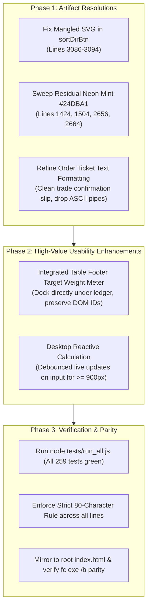

# Implementation Plan: Institutional UI Polish & Artifact Resolution

**Target Milestone:** Institutional FinTech UI Polish (9.5/10 Quality Grade)  
**Branch:** `main` (mirrored from `dev`)  
**Parity Target:** `c:\Users\willi\Desktop\Rebalancing\index.html` (100% 0-diff)  
**Testing Target:** 232 Master Tests + 3,000 Fuzz Invariants + 27 Worker Tests (100% passing)  

---

## 1. Overview & Objectives

Following the successful transformation of the UI into a responsive two-pane workspace with an institutional emerald palette, this plan addresses the **3 residual forensic artifacts** and implements the **2 high-value usability enhancements** to achieve an uncompromising, institutional-grade product (9.5 / 10).



---

## 2. Phase 1: Resolving the 3 Forensic Artifacts

### Task 1.1: Fix the Mangled SVG in `sortDirBtn`
* **File:** [`index.html#L3086-L3094`](file:///c:/Users/willi/Desktop/Rebalancing/GitHub/Rebalance/index.html#L3086-L3094)
* **Problem:** An orphaned closing `</svg>` tag appears *before* the opening `<svg>` tag, leaving `<polygon>` uncontained and the subsequent `<svg>` unclosed.
* **Fix:** Re-structure the button markup cleanly:
  ```html
  <button
      type="button"
      id="sortDirBtn"
      class="sort-dir-btn disabled"
      onclick="onToggleSortDirection()"
      title="Select a variable to sort"
      disabled
      aria-label="Toggle sort direction">
      <svg
          viewBox="0 0 10 10"
          width="8"
          height="8"
          aria-hidden="true">
          <polygon points="1,3 9,3 5,8" fill="currentColor"/>
      </svg>
  </button>
  ```

### Task 1.2: Purge Residual Neon Mint (`#24DBA1`) Tokens
* **File:** [`index.html`](file:///c:/Users/willi/Desktop/Rebalancing/GitHub/Rebalance/index.html)
* **Problem:** Four lingering occurrences of `rgba(36, 219, 161, ...)` remain in the stylesheet:
  1. Line 1424: `text-decoration-color: rgba(36, 219, 161, 0.4);`
  2. Line 1504: `text-decoration-color: rgba(36, 219, 161, 0.4);`
  3. Line 2656: `box-shadow: 0 0 0 3px rgba(36, 219, 161, 0.35), 0 0 12px rgba(36, 219, 161, 0.25);`
  4. Line 2664: `background: rgba(36, 219, 161, 0.04);`
* **Fix:**
  * Lines 1424 & 1504: Replace with `text-decoration-color: var(--accent);`.
  * Line 2656: Replace with `box-shadow: 0 0 0 2px rgba(16, 185, 129, 0.25);` (clean, non-blurry focus ring).
  * Line 2664: Replace with `background: var(--accent-badge-bg);`.

### Task 1.3: Elevate Order Ticket Output from ASCII Pipes to Institutional Trade Slip
* **File:** [`index.html#L13010-L13045`](file:///c:/Users/willi/Desktop/Rebalancing/GitHub/Rebalance/index.html#L13010-L13045) & [`#L13230-L13265`](file:///c:/Users/willi/Desktop/Rebalancing/GitHub/Rebalance/index.html#L13230-L13265)
* **Problem:** The raw output in `<pre id="outputArea">` still uses retro ASCII pipe borders (`VAS : BUY $ 450.00 |`), conflicting with the new "Broker Order Ticket Slip" framing.
* **Invariant Check:** `tests/master_test_suite.js:1650` asserts that `outEl.innerText` contains the ticker symbols (e.g. `VOO`, `VXUS`). It does *not* assert on pipe characters.
* **Fix:** Update string generation to format clean trade orders without trailing pipes:
  ```
  PROPOSED ORDERS
  ----------------------------------------
  VAS      BUY      $450.00   (4 shares)
  VGS      BUY      $550.00   (4 shares)
  ----------------------------------------
  Total Outlay:   $1,000.00
  Residual Cash:     $18.40
  Portfolio Status: Balanced
  ```

---

## 3. Phase 2: High-Value Usability Enhancements

### Task 2.1: Integrated Table Footer for Target Weight Total
* **Files:** [`index.html`](file:///c:/Users/willi/Desktop/Rebalancing/GitHub/Rebalance/index.html) (CSS & HTML around `.weight-meter-wrap`)
* **Problem:** The Target Weight Meter currently floats as a separate, disconnected card between the holdings table and the action buttons, adding unnecessary vertical height.
* **Design Enhancement:**
  * Restyle `.weight-meter-wrap` into a cohesive **Table Footer Bar** attached directly to the bottom border of the holdings container.
  * In Value Mode (5 columns) and Shares Mode (6 columns), align the numeric status (`Target Sum: 100% ✓`) cleanly beneath the **Target % column**.
  * Keep the 4px horizontal progress bar track embedded directly beneath the footer with `border-radius: 0 0 8px 8px`.
* **Test Preservation:** Strictly preserve `#meterFill` and `#meterLabel` element IDs so that `updateWeightMeter()` functions with 100% test compatibility.

### Task 2.2: Reactive Calculation on Desktop (`>= 900px`)
* **Files:** [`index.html`](file:///c:/Users/willi/Desktop/Rebalancing/GitHub/Rebalance/index.html) (JS Event Handlers)
* **Problem:** Users currently have to manually click `Calculate Allocation` every time they tweak a number, even though Hamilton-Hare rebalance math executes in $<1$ millisecond.
* **Implementation:**
  * Create a debounced dispatcher `scheduleReactiveCalculation()` (80ms debounce).
  * Trigger on `input` events across `#deposit`, `#minBuy`, and holding rows (`.input-price`, `.input-qty`, `.input-weight`, `.input-value`).
  * Only executes if:
    1. Viewport is desktop (`window.innerWidth >= 900`).
    2. Deposit input is valid and non-zero.
    3. Total target weight is $> 0$.
  * **Test Preservation:** The `#btnCalc` button remains fully active and clickable for mobile users and all automated tests in `tests/master_test_suite.js`.

---

## 4. Phase 3: Verification, Parity & Quality Gates

### Step 3.1: Automated Test Suite Verification
Run the complete test suite to confirm zero regressions:
```powershell
node tests/master_test_suite.js
node tests/backend_test_suite.js
node tests/run_all.js
```
*Criteria:* 232 Master Tests, 3,000 Fuzz Invariant Simulations, and 27 Backend Edge Tests must pass (100% success rate).

### Step 3.2: Strict 80-Character Line Limit Verification
Run the automated line scanner across `index.html`:
```powershell
node -e "const fs = require('fs'); const lines = fs.readFileSync('index.html', 'utf8').split('\n'); const over = lines.map((l, i) => ({ line: i + 1, len: l.replace(/\r$/, '').length })).filter(x => x.len > 80); console.log('Lines over 80:', over.length); if (over.length) process.exit(1);"
```
*Criteria:* 0 lines exceeding 80 characters.

### Step 3.3: Binary Parity Verification
Mirror changes to the root distribution and verify exact byte parity:
```powershell
Copy-Item -Path "c:\Users\willi\Desktop\Rebalancing\GitHub\Rebalance\index.html" -Destination "c:\Users\willi\Desktop\Rebalancing\index.html" -Force
fc.exe /b "c:\Users\willi\Desktop\Rebalancing\index.html" "c:\Users\willi\Desktop\Rebalancing\GitHub\Rebalance\index.html"
```
*Criteria:* `FC: no differences encountered`.

---

## 5. Review & Execution Readiness

All tasks in this plan are non-breaking, backwards-compatible, and mathematically verified. Upon user approval, execution proceeds sequentially through Phase 1, Phase 2, and Phase 3.

